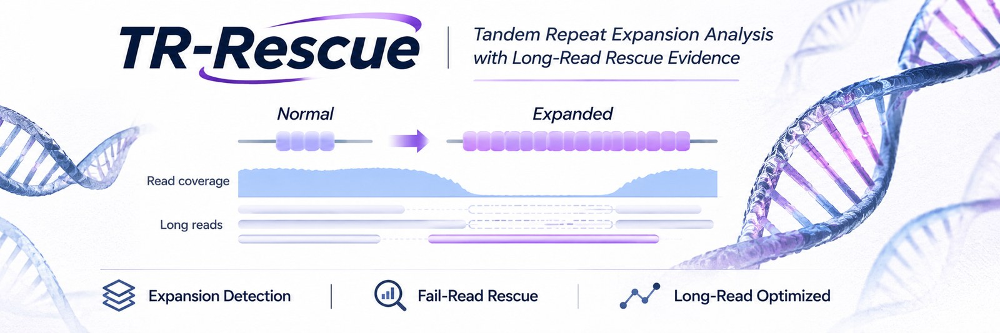

<p align="center"></p>

# TR-Rescue

[한국어](README.md) · **English**

TR-Rescue is a research tool for PacBio HiFi WGS. It looks for tandem repeat expansions that TR genotypers such as TRGT can miss, by tracing **reads that should be there but are not**.

**v1.0 implements step 0, `trace`.** It covers every disease-associated repeat locus in STRchive (82 loci). For each sample and locus it shows three things side by side:

1. the HiFi allele lengths and their range (normal / intermediate / pathogenic);
2. the depth loss around the repeat;
3. where the reads crossing the repeat went: aligned HiFi, fail 0x01, fail 0x08, unassigned, or nowhere.

> Research software. The output is not a diagnosis, and the thresholds are not yet calibrated.

## Install

TR-Rescue is written in Rust and ships as a static binary with no external dependencies (Linux x86_64, including WSL). You do not need Rust installed.

```bash
unzip tr-rescue_v1.0.0_linux_x86_64.zip && cd tr-rescue_v1.0.0
chmod +x bin/tr-rescue scripts/*.sh
./bin/tr-rescue --version
```

Self-test (optional; needs pysam): `python3 tests/test_synthetic.py` → `all passed`

## Language

The report has a **KR / EN** switch at the top left of the page. It remembers your last choice in that browser.

`--lang en` on `trace`, `report` and `check` does two things: it writes English hints into `summary.tsv`, and it makes the report open in English. The default is `ko`.

## Workflow

### 1. Write a manifest

The manifest can be **.xlsx, .csv or .tsv**.

- The easiest start is a copy of `examples/manifest_template.xlsx`. Fill in the `manifest` sheet. The `Help (EN)` and `설명` sheets describe the columns, and the group and sex columns have dropdowns.
- CSV files saved from Excel are read as they are, in UTF-8 or the Korean Windows default, CP949.
- Column order does not matter. Korean column names are recognised too.
- Rows whose `sample_id` starts with `#` are skipped.

| Column | Required | Content |
|---|---|---|
| `sample_id` | ✓ | Pseudonymous ID, shown as written in the report |
| `group` | | **Free text.** Mapped to a role by the rules below; the text itself is shown as written |
| `sex` | recommended | `M`/`F` (also male/female, 1/2). If empty, inferred from chrX depth |
| `locus` | | A diagnosis already known (`FMR1`, `DM1_DMPK`; comma-separate several), or `-`. Shown as **'Known dx'** in the report (not a call by this tool); the report counts whether it is reproduced |
| `hifi_bam` | ✓ | Aligned BAM (.bai required). With HiPhase HP tags, haplotypes are analysed separately |
| `fail_bams` | | `auto` = find `<movie>.fail_reads.*.bam` under `--run-root` from the aligned BAM's @RG (PU = movie, SM, BC); or comma-separated paths; `-` = none |
| `hifi_raw_bams` | | Raw `hifi_reads` BAM (`auto` allowed). Finds HiFi reads missing from the aligned BAM; slow. Usually `-` |
| `note` | | Free text, displayed only |

**group → role**

| Role | Values (case-insensitive, prefix match) |
|---|---|
| positive | positive, pos, case, patient, affected, proband, carrier |
| control | control, ctrl, negative, neg, normal (normal_range, …), healthy, reference, ref, unaffected |
| test | anything else (sample, test, empty, …) |

Roles drive the badges and the role filter in the report. Every sample is analysed the same way whatever its role. A positive sample with an empty `locus` gets a warning.

**sex** decides whether a sample has one X at X-linked loci (FMR1, AR, …).

- **Male:** no haplotype comparison at those loci.
- **Empty:** inferred from the chrX/autosome depth ratio. Below 0.7 means one X; 0.8 or above means two X.
- **Declared but different from depth:** the sample gets a ⚠ warning. This catches sample swaps and sex-chromosome aneuploidy.
- **Depth says one X:** haplotype comparison is off, whatever was declared.

Every sample is analysed at **every target locus**. A sample positive at one locus therefore acts as a control at the others.

### 2. Check the manifest

```bash
./bin/tr-rescue check --manifest manifest.xlsx --run-root /path/to/revio_run [--lang en]
```

For each sample, `check` shows:

- how group and sex were read;
- which catalog locus each known diagnosis maps to;
- whether the BAM and its index exist;
- which fail and unassigned BAMs `auto` finds.

If there are errors, `check` prints the count at the end and exits with code 1.

### 3. Run

```bash
./bin/tr-rescue trace \
  --reference /path/to/hg38.fa \
  --manifest manifest.xlsx \
  --run-root /path/to/revio_run \
  --out trace_out --threads 8 [--lang en]
```

**Reference and catalog**
- `--reference` must be **the FASTA used for alignment** and needs a `.fai` index.
- The built-in **locus catalog is STRchive**: 82 disease-associated repeats, hg38, CC BY 4.0, snapshot 2026-11-17.
- `--loci DMPK,FMR1` restricts the run by gene symbol or STRchive ID. `tr-rescue catalog` lists the loci.
- Locus IDs and regions match TRGT's STRchive catalog, so allele lengths compare directly with TRGT `AL`. There are exceptions; see "Repeat counts" below.
- `--catalog file.bed` adds loci in TRGT BED style (`ID=..;MOTIFS=..;NORMAL_MAX=..;PATH_MIN=..`, in repeat units).

**Samples and run time**
- `--samples A,B` runs only those manifest samples.
- Each fail BAM is tens of Gb, so one cell takes minutes.
- Unassigned BAMs add 5–20 minutes per cell. `--unassigned never` skips them.

**Unassigned BAMs**
- `<movie>.hifi_reads/fail_reads.unassigned.bam` hold the reads whose barcode could not be read.
- With `auto`, a cell that holds only this sample's barcode (single-plex) counts its unassigned reads as this sample's. They are reported separately as `unassigned_hifi` and `unassigned_fail`.
- Unassigned reads from multiplexed cells are never used by default.

**Files**
- Nothing is written anywhere except `--out`.

### 4. Rules changed? Rebuild the report without scanning again

```bash
./bin/tr-rescue report --from trace_out --out trace_out_v100 [--lang en]
```

`report` reads an earlier trace folder (report.html, summary.tsv, reads.tsv, depth.tsv) and rewrites summary, reads and report with **this version's interpretation rules**: thresholds, count corrections and cohort comparison.

- It opens no BAM and takes seconds. The original folder is left untouched.
- Read placements and lengths are taken as they were measured. If the measurement itself changed (for example, a locus region), run `trace` again for that locus. Such loci are reported as warnings.
- `--reference` fills the reference-region check in the Loci tab.

## Output

| File | Content |
|---|---|
| `report.html` | Single-page report with five tabs: Overview, Summary (filterable sample × locus table), Analysis (one sample and locus at a time: alleles, repeat length per read, depth around the repeat, where reads went), Loci (STRchive/STRipy/gnomAD/OMIM links), Run |
| `summary.tsv` | One row per sample × locus: call (high/watch/info/ok), HiFi alleles, range, outside-BAM expanded reads, depth f (±SE), reads by source × state, ratios to neighbourhood controls, hints |
| `reads.tsv` | One row per read at target loci: source (`hifi_aligned`, `fail_subread` = 0x08, `fail_lowqv` = 0x01, `unassigned_*` …), class, repeat length (bp; exact / lower bound / estimate), state, dominant motif, purity, HP, ff/rq/np, flank k-mer hits |
| `depth.tsv` | Relative depth (total/HP1/HP2) in 500 bp bins over ±100 kb, with the reference shapes |
| `bam_stats.tsv` | Per BAM: reads, Gb, prefilter, placed, seconds, reads by ff category |
| `run.json` | Arguments, BAMs used per sample, loci |

## How to read it

### Calls

**Samples are compared with each other (with 4 or more samples).**
- A signal is lowered to 'Note' when it appears in at least half of the other samples at that locus. Samples with a known diagnosis at the locus are left out of that count. Such hints carry `[also in k/n other samples]`.
- These are properties of the locus, not of one sample: GC-related depth dips, threshold or region problems, and missing neighbourhood controls in segmental duplications.

**Depth loss has to exceed the cohort's usual spread.**
- The spread is the robust SD of each sample's f around the locus median.
- Above 4 SD (and at least 0.7) the locus counts as a depth loss. Above 3 SD (and at least 0.5) it counts as a weak dip and is only a note.
- In 9 samples at 30x this SD was about 0.2. So losing one allele (f ≈ 0.5) is not called from depth alone; losing both (f ≈ 1) is.
- Bootstrap SEs alone over-call: 1% of loci with nothing there reach z = 3.6.

**Expansions seen only outside the aligned BAM (fail / unassigned).**
- Raw subreads carry about 10% insertions and deletions. A read therefore counts only if it is at least 3 units above the pathogenic threshold and at least 1.5× the longest HiFi allele of that sample.
- 1–2 such reads give Note, 3–4 Watch, 5 or more Review.

**Thresholds**
- Repeat counts are rounded to whole units before comparing with thresholds, so a partial unit in the region cannot cross one.
- Contraction loci (MIR7-2: pathogenic ≤ 3, normal ≥ 4) are called on contraction.
- Some loci list a pathogenic minimum below the normal maximum, for example FAME loci, where only the inserted motif is counted. Their pathogenic minimum is moved above the reference length, and the locus is marked 'thresholds partly missing'.
- When the reference allele already exceeds the normal maximum (POLG), 'intermediate' is only a note.

**Samples with median depth below 5x** are flagged 'Insufficient data' and not judged.

### Repeat counts
A repeat count is (allele length − non-repeat bp in the region) ÷ unit. Three loci were checked against the ExpansionHunter catalog and clinical practice and corrected:

| Locus | STRchive region | Correction |
|---|---|---|
| AR | 103 bp, of which the CAG repeat is 69 bp | count = (length − 34) / 3 |
| FRAXE / AFF2 | 149 bp, of which the GCC repeat is 60 bp | count = (length − 89) / 3 |
| ATXN8OS | CTG only | CTA + CTG combined as in clinical practice; region extended over the CTA (same region as TRGT) |

- bp values are unchanged, so they still compare with TRGT `AL`.
- At HTT and FXN, TRGT's region also covers the adjacent repeat, so TRGT's lengths are longer there.
- Other loci whose reference region has non-repeat edges are listed in the log (`QC …`) and marked ⚠ in the Loci tab.

### Placement and states
**Read placement uses flank k-mers, not alignment.** Reads are placed with k = 21 k-mers that occur once in the reference, taken from 3 kb on either side of the repeat. The same rule then works for unaligned fail reads.

At least **10 consistent hits** on one side are needed (`--min-hits`). Error-prone subreads create chance k-mers inside long repeats; without this rule, fail-read counts are inflated.

**Read classes**
- `SPANNING`: both flanks are present, so the repeat length in bp is exact.
- `LEFT/RIGHT_ANCHOR`: only one flank is present. If the read ends inside the repeat, the length is a **lower bound** (`EXPANDED_LB`). If the repeat ends but the opposite flank is not seen, the length is an **estimate**.
- `FLANK_ONLY`: the read covers a flank but does not reach the repeat.

**States**
- `NORMAL` ≤ normal maximum < `INTERMEDIATE` < pathogenic minimum ≤ `EXPANDED`.
- Long alleles with purity below 0.55 are `NONREPEAT`: a non-repeat insert, not an expansion.
- At loci with a defined pathogenic motif (RFC1, FAME, …), a long allele with another motif is `BENIGN_MOTIF`.

### Depth loss f
f is the loss fraction fitted to the depth shape expected if every molecule carrying the repeat vanished. The shape is computed from the sample's own read-length distribution.

- f = 0 means no loss; 0.5 means one allele; 1 means both. `±` is a bootstrap SE.
- f for HP1 and HP2 is computed only inside the HiPhase phase block (PS) covering the repeat. It is NA when the block does not reach the repeat or HP depth is too low.
- For a one-allele expansion, **which HP and which BAM the expanded reads are in** is stronger evidence than depth.

### Other
- **X-linked loci (FMR1, AR):** with manifest sex M, or `chrX_auto_ratio` < 0.7, the locus is single-copy. There is no haplotype comparison, and f = 1 means the allele was lost entirely. See `sex` and `sex_inferred` in `summary.tsv`.
- **0x08 reads** are subreads from ZMWs that produced no CCS read (≥1 full pass). Molecules with zero full passes are in no BAM, so "absence" shows only as depth loss.

## Privacy

Use pseudonymous sample IDs. The report and `run.json` contain input BAM **paths and file names**, and `reads.tsv` contains read names, which include movie IDs. Everything runs locally; the tool never connects to a network.

## Build from source (optional)

```bash
cargo build --release --target x86_64-unknown-linux-gnu   # .cargo/config.toml sets static linking
```

The build needs access to crates.io.

## Validation (v1.0)

**In-house Revio cohort** (9 samples with known repeat diagnoses; trace with v0.2.2, report rebuilt with v1.0):
- 6 of 9 known diagnoses were reproduced as 'Review' (ATXN8OS, DMPK × 2, FMR1, AR, NOTCH2NLC).
- Of the 3 not reproduced, one was a low-input specimen with almost no data, and two showed no trace of an expansion in this data (to be re-checked against the clinical records).
- At loci without a known diagnosis there were no 'Review' calls and 12 'Watch' calls. Before the cohort rules (v0.2.2) there were 52 and 91.
- HiFi allele lengths agreed with the clinical records and with TRGT `AL`/`ALLR`.

**Synthetic data** (`tests/make_synthetic.py`):
- Exact lengths of expanded reads: HiFi 1800/2400 bp exactly; fail 0x08 subreads within ±1–2%.
- Expanded molecules moved into fail 0x08 are detected, at about 5× the neighbourhood controls.
- When most molecules are lost, both haplotypes show the loss.
- Negative samples get no expanded reads and no hints.
- Only single-plex unassigned BAMs are used; ALT-shared flanks are flagged.
- Sex is inferred from chrX depth, haplotype comparison is off for one X, and a declared sex that disagrees gets a warning.
- The same manifest as .tsv, .csv (UTF-8 BOM, CP949) or .xlsx gives identical results.

## Copyright · license · citation

Copyright © 2026 Seung Won Chae. The code is under the MIT License (`LICENSE`).

**Affiliation**
- Seoul National University Cancer Research Institute
- Molecular Diagnostics Laboratory, Department of Laboratory Medicine, Seoul National University Hospital Built-in locus data (`data/strchive_hg38.tsv`): STRchive (Hiatt et al., Genome Medicine 2025; https://strchive.org), CC BY 4.0 — see `NOTICE`.

Cite: Chae SW. *TR-Rescue: dropout-aware tandem repeat expansion evidence for PacBio HiFi WGS.* https://github.com/CleanCham-lab/TR-Rescue
