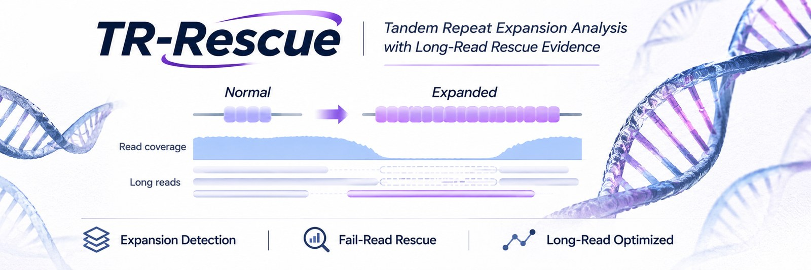

<p align="center"></p>

# TR-Rescue

**한국어** · [English](README.en.md)

PacBio HiFi WGS에서 기존 TR genotyper(TRGT 등)가 놓칠 수 있는 tandem repeat 확장을 **"있어야 할 read가 사라진 흔적"**으로 찾는 연구용 도구입니다.

**v1.0은 0단계(`trace`)를 구현합니다.** 질환 관련 반복 좌위 전체(STRchive 82개)에서 샘플마다 ① HiFi allele 길이와 범위(정상/중간/병적), ② 반복 주변 depth 함몰, ③ 반복을 지나는 read가 어디로 갔는지(HiFi / fail 0x01 / fail 0x08 / unassigned / 어디에도 없음)를 함께 보여 줍니다. 

> 연구용 소프트웨어입니다. 출력은 진단 결론이 아니며, 임계값은 아직 보정(calibration)되지 않았습니다.

## 설치

Rust로 작성했고, 외부 라이브러리 의존이 없는 static 바이너리로 배포합니다(Linux x86_64, WSL 포함). Rust 설치는 필요 없습니다.

```bash
unzip tr-rescue_v1.0.0_linux_x86_64.zip && cd tr-rescue_v1.0.0
chmod +x bin/tr-rescue scripts/*.sh
./bin/tr-rescue --version
```

자가 테스트(선택, pysam이 있는 환경에서): `python3 tests/test_synthetic.py` → `all passed`

## 언어 (KR / EN)

보고서 왼쪽 위의 **KR / EN** 버튼으로 언어를 바꿉니다(브라우저에 마지막 선택을 기억). `trace` · `report` · `check`에 `--lang en`을 주면 `summary.tsv`의 참고 문구가 영어로 나오고 보고서도 영어로 열립니다(기본 `ko`). 영문 설명서는 [README.en.md](README.en.md)입니다.

## 실행 순서

### 1. manifest 작성

**.xlsx · .csv · .tsv 어느 것이든 됩니다.** 가장 쉬운 방법은 `examples/manifest_template.xlsx`를 복사해 채우는 것입니다(`manifest` 시트에 입력, `설명`·`Help (EN)` 시트에 열 설명, group·sex는 드롭다운). CSV는 Excel에서 저장한 것(UTF-8 또는 한글 Windows 기본 CP949) 그대로 읽습니다. 열 순서는 상관없고, 열 이름은 한글(샘플, 그룹, 성별, 확진 좌위, 비고)도 인식합니다. `sample_id`가 `#`로 시작하는 행은 건너뜁니다.

Revio 프로젝트 폴더에 `HiPhase_QC/`가 있으면 초안을 만들 수 있습니다.

```bash
scripts/make_manifest.sh /data/project_dir > manifest.tsv
```

| 열 | 필수 | 내용 |
|---|---|---|
| `sample_id` | ✓ | 가명 ID (보고서에 그대로 표시됨) |
| `group` | | **자유 입력.** 아래 규칙으로 역할을 정하고, 적은 글자는 보고서에 그대로 보여 줍니다 |
| `sex` | 권장 | `M`/`F` (남/여, male/female, 1/2도 인식). 비우면 chrX depth로 추정 |
| `locus` | | 이미 아는 진단 좌위(`FMR1`, `DM1_DMPK`; 여러 개면 쉼표). 없으면 `-`. 보고서에 **'기존 진단'**으로 표시되고(도구 판정 아님), 이 데이터에서 재현됐는지 셉니다 |
| `hifi_bam` | ✓ | 정렬 BAM(.bai 필요). HiPhase HP 태그가 있으면 haplotype별 분석 |
| `fail_bams` | | `auto` = 정렬 BAM 헤더의 @RG(PU=movie, SM, BC)로 `--run-root` 아래 `<movie>.fail_reads.*.bam`을 찾음. 직접 적을 땐 쉼표로 경로 나열, `-` = 안 씀 |
| `hifi_raw_bams` | | 원본 `hifi_reads` BAM(`auto` 가능). 정렬본에서 빠진 HiFi read 확인용이며 느립니다. 보통 `-` |
| `note` | | 자유 메모. 보고서에 표시만 하고 분석에는 쓰지 않습니다 |

**group → 역할**

| 역할 | 이렇게 적으면 (대소문자 무관, 앞부분 일치) |
|---|---|
| 양성 | positive, pos, case, patient, affected, proband, carrier, 양성, 환자, 확진, 보인자 |
| 대조 | control, ctrl, negative, neg, normal(normal_range 등), healthy, reference, ref, unaffected, 음성, 정상, 대조, 참조 |
| 검사 | 그 밖의 모든 값(sample, test, 빈칸 등) |

역할은 보고서의 배지와 '역할' 필터에 쓰입니다. 분석 자체는 역할과 관계없이 모든 샘플을 같은 방식으로 합니다. 양성인데 `locus`가 비어 있으면 경고를 냅니다.

**sex**: X 연관 좌위(FMR1, AR 등)에서 X가 하나인지 정하는 데 씁니다. 남성이면 그 좌위에서 haplotype(HP) 비교를 하지 않습니다. 비워 두면 chrX/상염색체 기준 depth 비(0.7 미만 → X 1개, 0.8 이상 → X 2개)로 추정합니다. 적은 값과 depth 추정이 다르면 샘플에 ⚠ 경고(샘플 바뀜이나 성염색체 이수성 확인용)가 붙고, depth가 X 1개를 가리키면 적은 값과 관계없이 HP 비교를 끕니다.

모든 샘플은 **모든 대상 좌위**에서 분석됩니다. 그래서 FXN 양성 샘플은 RFC1에서는 자연스럽게 음성 대조 역할을 합니다.

### 2. manifest 점검

```bash
./bin/tr-rescue check --manifest manifest.xlsx --run-root /data/revio_run [--lang en]
```

샘플마다 group이 어떤 역할로, sex가 어떻게 읽혔는지, 확진 좌위가 카탈로그의 어느 좌위로 연결되는지, BAM과 index가 있는지, `auto`가 어떤 fail BAM을 찾는지 보여 줍니다. 오류가 있으면 끝에 개수를 알려 주고 종료 코드 1로 끝납니다.

### 3. fail BAM 자동 탐색만 따로 보기 (선택)

```bash
./bin/tr-rescue locate --run-root /data/revio_run --bam /data/project_dir/HiPhase_QC/<샘플>.hiphase.haplotagged.bam
```

`fail_reads <경로>`가 나오면 `auto`를 그대로 쓰면 됩니다. 아무것도 안 나오면 해당 run 폴더가 run root 아래에 없는 것이므로 `--run-root`를 바꾸거나 manifest에 경로를 직접 적습니다.

**unassigned BAM** (`<movie>.hifi_reads.unassigned.bam`, `<movie>.fail_reads.unassigned.bam`)은 barcode를 판별하지 못한 read입니다. 긴 확장 분자는 pass 수가 적어 barcode 판별도 약하므로 이쪽으로 빠질 수 있습니다. `auto`일 때 셀 폴더에 barcode BAM이 **이 샘플 것 하나뿐(single-plex)**이면 unassigned를 이 샘플 read로 보고 함께 스캔하며, 출처를 `unassigned_hifi` / `unassigned_fail`로 따로 셉니다(정렬본·fail read 수와 섞지 않음). 여러 샘플을 섞은 셀의 unassigned는 다른 샘플 read가 섞이므로 쓰지 않습니다. `--unassigned never`로 끄고, `--unassigned always`로 섞인 셀까지 넣을 수 있습니다(권장 안 함). manifest에 unassigned 경로를 직접 적어도 unassigned 출처로 셉니다.

### 4. 실행

```bash
./bin/tr-rescue trace \
  --reference /data/ref/hg38.fa \
  --manifest manifest.xlsx \
  --run-root /data/revio_run \
  --out trace_out \
  --threads 8
```

- `--reference`는 **정렬에 쓴 것과 같은 FASTA**(코호트는 ALT 포함 hg38.fa)여야 하며 `.fai`가 필요합니다.
- `--run-root`는 여러 개를 줄 수 있습니다(run 폴더가 여러 위치에 나뉘어 있을 때).
- **좌위 카탈로그는 STRchive**(질환 관련 반복 82개, hg38, CC BY 4.0; 2026-11-17 스냅샷)를 내장합니다. 기본은 **82개 전체**를 분석하고, `--loci DMPK,FMR1`처럼 유전자 기호나 STRchive ID로 좁힐 수 있습니다. `./bin/tr-rescue catalog`로 목록을 볼 수 있습니다. 좌표가 TRGT의 STRchive 카탈로그와 같아서 allele 길이를 TRGT `AL` 값과 바로 비교할 수 있습니다.
- manifest `locus` 열은 **기존 진단 좌위 표시용**입니다. 보고서에 '기존 진단'으로 표시하고 이 데이터에서 재현됐는지 셉니다(상태 패널 '기존 진단 재현'을 누르면 재현 안 된 행만 보임). 분석 대상 좌위를 제한하지는 않습니다.
- **반복 수 보정:** 반복 수는 (allele 길이 − 구간 안 비반복 bp) ÷ 반복 단위로 셉니다. STRchive 구간이 임상 반복 수와 다른 3개 좌위는 ExpansionHunter 카탈로그·임상 관례와 대조해 보정했습니다: **AR**(구간 103 bp 중 CAG 반복 69 bp, 반복 수 = (길이 − 34) ÷ 3), **FRAXE/AFF2**(149 bp 중 GCC 60 bp, (길이 − 89) ÷ 3), **ATXN8OS**(임상 관례대로 CTA+CTG 합산, 구간을 CTA까지 넓힘 = TRGT 구간). bp 값은 그대로이므로 TRGT `AL`과 비교할 수 있습니다(HTT·FXN 등 TRGT가 인접 반복까지 넓게 잡는 좌위는 TRGT 값이 더 김). 그 밖에 참조 서열상 구간 가장자리에 반복이 아닌 서열이 있는 좌위는 실행 로그(`QC ...`)와 '좌위 정보' 탭에 ⚠로 표시합니다.
- **polyalanine 좌위(GCN/NGC motif: ARX, PHOX2B, PABPN1, HOXA13 등)**는 v0.2.1까지 motif의 N을 처리하지 못해 확장을 놓칠 수 있었습니다. v0.2.2부터 N을 A/C/G/T로 펼쳐 셉니다.
- 다른 좌위는 TRGT 형식 BED를 `--catalog`로 추가합니다(`ID=..;MOTIFS=..;NORMAL_MAX=..;PATH_MIN=..`, 반복 횟수 단위).
- 실행할 때마다 reference 전체에서 flank k-mer 유일성을 셉니다(수십 초~1분). `--panel-cache 경로`를 주면 저장해 두고 재사용합니다(전체 카탈로그 기준 약 100 MB라 결과 폴더 밖에 두세요).
- fail BAM은 셀당 수십 Gb라 셀 하나에 수 분이 걸립니다(네트워크 드라이브 속도에 좌우).
- 입력 쪽(run 폴더, BAM)에는 아무것도 쓰지 않습니다. 출력은 `--out`에만 씁니다.

일부 샘플만 다시 돌릴 때는 `--samples S01,S02`처럼 manifest의 sample_id를 고릅니다. unassigned BAM까지 읽으면 셀당 5–20분이 더 걸리므로, 빨리 볼 때는 `--unassigned never`를 줍니다.

### 5. 해석 규칙만 바뀌었을 때: 다시 스캔하지 않고 보고서만 새로 만들기

```bash
./bin/tr-rescue report --from trace_out --out trace_out_v100
```

이전 `trace` 결과 폴더(report.html, summary.tsv, reads.tsv, depth.tsv)만 읽어서 **현재 버전의 판정 규칙**(기준값, 반복 수 보정, 코호트 비교)으로 summary·reads·report를 다시 씁니다. BAM은 열지 않으므로 몇 초면 끝나고, 원래 폴더는 그대로 둡니다. read 배치와 길이는 그때 측정한 값을 씁니다. 그래서 측정 자체가 바뀐 경우(예: v0.2.2의 polyalanine motif 수정, 좌위 구간 변경)는 해당 좌위를 `trace`로 다시 돌려야 하며, 구간이 바뀐 좌위는 실행 중 경고로 알려 줍니다. `--reference`를 주면 '좌위 정보' 탭의 참조 구간 점검(⚠)도 채웁니다.

## 출력

| 파일 | 내용 |
|---|---|
| `report.html` | 화면 하나로 보는 결과. 왼쪽 탭: **개요**(도구 소개, 보는 순서, 용어, 좌위 출처, 입출력) · **요약**(필터되는 샘플×좌위 표) · **분석**(샘플·좌위 하나씩: allele 요약, read별 반복 길이, 주변 depth, read 행방) · **좌위 정보**(82개 좌위, STRchive/STRipy/gnomAD/OMIM 링크) · **실행 정보** |
| `summary.tsv` | 샘플×좌위 한 줄: 판정(high/watch/info/ok), HiFi allele 요약, 범위, fail read 확장 수, depth f(±SE), 출처×상태별 read 수, 이웃 대조 대비, 참고 문구 |
| `reads.tsv` | 대상 좌위의 read 한 줄: 출처(`hifi_aligned`, `fail_subread`=0x08, `fail_lowqv`=0x01 …), 분류, 반복 길이(bp, 정확/하한/추정), 상태, 우세 motif, 순도, HP, ff/rq/np, flank k-mer 수 |
| `depth.tsv` | ±100 kb, 500 bp bin별 상대 depth(전체/HP1/HP2)와 비교 기준선 |
| `bam_stats.tsv` | BAM별 read 수, Gb, 1차 통과, 좌위 배치 수, 소요 시간, ff 범주별 read 수 |
| `run.json` | 실행 인자, 샘플별 사용 BAM, 좌위 정보 |

## 읽는 법

- **판정은 샘플 하나만 보지 않고 코호트와 비교합니다(샘플 4명 이상일 때).** 같은 좌위에서 다른 샘플(그 좌위가 기존 진단이 아닌 샘플) 절반 이상에서 같은 신호가 나오면, 좌위 자체의 특성으로 보고 '참고'로 낮춥니다. 이런 특성에는 GC가 많은 구간의 depth 감소, 기준값·구간 문제, 분절중복 때문에 이웃 대조가 없는 경우가 있습니다. 해당 문구에는 `[다른 샘플 k/n명도 같음]`이 붙습니다.
- **depth 함몰은 코호트의 평소 흔들림을 넘어야 씁니다.** 각 좌위 중앙값에서 벗어난 정도의 robust SD를 구하고, 그 4배(최소 0.7)를 넘으면 '함몰'로 봅니다. 3배(최소 0.5)를 넘으면 '약한 함몰'(참고)입니다. RED 9명에서 이 SD는 약 0.2였습니다. 그래서 30x에서 한쪽 allele 소실(f≈0.5)은 depth만으로는 판정하지 않고, 두 allele 소실(f≈1)만 잡힙니다. bootstrap 표준오차만 쓰면 아무것도 없는 좌위의 1%가 z 3.6을 넘어서 과대 판정이 됩니다.
- **정렬본 밖 read(fail·unassigned)에만 있는 확장**은 raw subread의 삽입·결실 오류를 감안해서, 병적 기준보다 3회 이상 길고 그 샘플의 가장 긴 HiFi allele보다 1.5배 이상 긴 read만 셉니다. 판정은 1–2개면 참고, 3–4개면 관찰, 5개 이상이면 확인 필요입니다.
- **반복 수는 반올림한 정수로 기준과 비교합니다.** 구간에 반복 단위 일부가 걸쳐 있어도 기준을 넘지 않게 하기 위해서입니다(COMP, CSTB 등). 축소가 병인인 좌위(MIR7-2: 병적 ≤3, 정상 ≥4)는 '축소'로 판정합니다. 병적 하한이 정상 상한보다 작게 적힌 좌위(FAME 계열처럼 삽입 motif 수만 세는 경우)는 참조 길이 위에 그만큼 더해진 길이로 바꾸고 '기준 일부 없음'으로 표시합니다. 참조 allele부터 정상 상한을 넘는 좌위(POLG)의 '중간 범위'는 구간·기준 불일치 가능성으로 보고 '참고'로 둡니다.
- depth 중앙값 5x 미만인 샘플은 '데이터 부족' 경고를 띄우고 판정하지 않습니다.

- **read 분류는 정렬이 아니라 reference에서 한 번만 나오는 flank k-mer(k=21, 반복 양쪽 3 kb)로 합니다.** 비정렬 fail read에도 같은 기준을 쓰기 위해서입니다. 한쪽 flank에서 **10개 이상** 일관되게 맞아야 배치합니다(`--min-hits`). 오류가 많은 subread는 고반복 서열을 읽다가 우연히 flank k-mer를 몇 개 만들어 내므로, 이 기준이 없으면 fail read 수가 크게 부풀려집니다(v0.1.x의 문제).
  - `SPANNING`: 양쪽 flank가 다 있어 반복 길이를 bp로 정확히 측정
  - `LEFT/RIGHT_ANCHOR`: 한쪽 flank만 있는 read. read가 반복 안에서 끝나면 길이는 **하한**(`EXPANDED_LB`), 반복이 끝난 뒤 반대 flank가 안 보이면 **추정**(`estimate`)입니다.
  - `FLANK_ONLY`: 반복까지 닿지 않고 flank에만 걸친 read
- **상태:** `NORMAL` ≤ 정상 상한 < `INTERMEDIATE` < 병적 하한 ≤ `EXPANDED` (기준은 STRchive). 정상 상한을 넘더라도 반복 순도가 0.55 미만이면 `NONREPEAT`(비반복 삽입, 확장으로 세지 않음), 병적 motif가 정해진 좌위(RFC1 등)에서 motif가 다르면 `BENIGN_MOTIF`입니다.
- **HiFi allele 요약:** 양쪽 flank를 다 지나는 HiFi read를 길이로 최대 두 묶음으로 나눠 길이·반복 수·HP·범위를 보여 줍니다. 크기 퍼짐이 크면(체세포 변이) 범위로 표시합니다.
- **depth 함몰 f:** 반복을 포함한 분자가 read째로 사라졌을 때 기대되는 모양(샘플의 read 길이 분포로 계산)에 관측 depth를 맞춘 소실 비율입니다. 0은 함몰 없음, 0.5는 한 allele 전부, 1은 두 allele 전부입니다. `±`는 read 재표본(bootstrap) 표준오차입니다. HP1/HP2의 f는 반복을 덮는 HiPhase phase block(PS) 안에서만, 그 block 안 반복에서 먼 bin을 기준으로 계산합니다(block이 반복에 닿지 않거나 HP depth가 부족하면 NA). HP당 depth는 전체의 절반이라 HP별 f의 표준오차는 0.2–0.4로 더 큽니다. 한쪽 확장 판단은 depth보다 **확장 read가 어느 HP·어느 BAM에 있는지**가 더 강한 근거입니다. **30x에서 샘플 하나의 f 표준오차는 대략 0.15–0.25**라서 양쪽 소실은 잘 보이지만 한쪽 소실은 경계선입니다. 반드시 음성 샘플의 같은 좌위 값과 비교하세요.
- **이웃 대조(`rel_to_ctl`):** 같은 염색체 ±100–160 kb의 6개 지점을 같은 방식으로 세어 평균을 냅니다. fail read 대조 대비 비율이 HiFi보다 뚜렷하게 크면 확장 분자가 fail 쪽으로 옮겨 갔다는 신호입니다.
- **ALT 경고:** 대상 좌위의 flank k-mer가 ALT contig에도 20% 이상 있으면, read가 ALT로 나뉘어 정렬되어 dropout 없이도 depth가 낮아질 수 있습니다(로그와 보고서 panel 표에 표시).
- **X 연관 좌위(FMR1, AR):** manifest `sex`가 M이거나, 같은 샘플의 상염색체 좌위 기준 depth와 비교한 `chrX_auto_ratio`가 0.7 미만이면 X 단일 사본으로 보고, 이때는 HP 비교가 없고 f 1이 그 allele 전부 소실을 뜻합니다. `summary.tsv`의 `sex`(manifest)와 `sex_inferred`(depth)를 같이 보세요.
- **0x08 read**는 CCS가 안 된 ZMW의 subread(full pass ≥1)입니다. full pass가 0인 분자는 어떤 BAM에도 없으므로 "부재"는 depth 함몰로만 보입니다.

## 개인정보

sample_id는 가명을 쓰세요. 보고서와 `run.json`에는 입력 BAM **경로와 파일명**이 들어갑니다. `reads.tsv`에는 read 이름(movie ID 포함)이 들어갑니다. 모든 처리는 로컬에서 하며 네트워크 접속은 없습니다.

## 소스에서 빌드 (선택)

```bash
cargo build --release --target x86_64-unknown-linux-gnu   # .cargo/config.toml이 static 링크 설정
```

crates.io 접속이 필요합니다(SSL 검사가 있는 기관망에서는 실패할 수 있으므로 동봉 바이너리 사용을 권장).

## 검증 상태 (v1.0)

**내부 Revio 코호트**(반복 확장 진단이 알려진 9명; v0.2.2 trace, v1.0 report로 재생성)
- 기존 진단 9개 중 6개를 '확인 필요'로 재현했습니다(ATXN8OS, DMPK×2, FMR1, AR, NOTCH2NLC).
- 재현되지 않은 3개 중 1개는 데이터가 거의 없는 저투입 검체였고, 2개는 이 데이터에서 확장 흔적이 없었습니다(임상 기록 재확인 대상).
- 기존 진단이 아닌 좌위의 '확인 필요'는 0개, '관찰'은 12개였습니다. 코호트 비교를 넣기 전(v0.2.2)에는 각각 52개, 91개였습니다.
- HiFi allele 길이는 임상 기록, TRGT `AL`/`ALLR`과 일치했습니다.

**합성 데이터**(`tests/make_synthetic.py`, 33개 검사)
- 확장 read의 정확한 길이: HiFi 1800/2400 bp 정확, fail 0x08 subread는 ±1–2%
- fail 0x08로 옮겨 간 확장 분자 검출(이웃 대조 대비 약 5배), 대부분 사라진 확장의 양쪽 haplotype 함몰
- 음성에서 확장 read와 참고 문구가 나오지 않음
- single-plex 셀의 unassigned만 사용, ALT 공유 경고
- chrX depth로 성별 추정, 남성 X 좌위 HP 비교 끄기, manifest 성별과 다를 때 경고
- 같은 manifest를 .tsv / .csv(UTF-8 BOM, CP949) / .xlsx로 줬을 때 같은 결과, `report` 재생성이 `trace`와 같은 판정, 영어 출력

## 저작권 · 라이선스 · 인용

Copyright © 2026 Seung Won Chae. 코드는 MIT 라이선스(`LICENSE`)입니다.

**소속**
- 서울대학교 암연구소 (Seoul National University Cancer Research Institute)
- 서울대학교병원 진단검사의학과 분자진단검사실 (Molecular Diagnostics Laboratory, Department of Laboratory Medicine, Seoul National University Hospital) 내장 좌위 자료(`data/strchive_hg38.tsv`): STRchive (Hiatt et al., Genome Medicine 2025; https://strchive.org), CC BY 4.0 — `NOTICE` 참고.

인용: Chae SW. *TR-Rescue: dropout-aware tandem repeat expansion evidence for PacBio HiFi WGS.* https://github.com/CleanCham-lab/TR-Rescue
